<picture>
  <source media="(prefers-color-scheme: dark)" srcset="./dark.svg">
  <source media="(prefers-color-scheme: light)" srcset="./light.svg">
  
</picture>

# Hi, I'm Vaidic Jain 👋

**Software Engineer · Frontend Specialist · Full-Stack Builder**

---

## 🧭 About

I'm a software engineer based in **Bhopal, India** with ~2 years of professional experience. I like solving real problems rather than just executing tickets. At a fast-moving startup I've grown from implementing features to owning them end-to-end, often working directly with stakeholders to figure out *what* needs to be built before figuring out *how*.

My strength is **React, Next.js, and TypeScript**. I'm now deliberately deepening my backend skills with **FastAPI**, so I can take an idea from a rough problem statement to a shipped, reliable product.

## 💼 Experience

**Software Development Engineer – I · [Duochat.io](https://duochat.io)** &nbsp;·&nbsp; *Sep 2024 – Present*
- Own frontend delivery for core modules of a **WhatsApp automation SaaS platform used by 500+ businesses**, defining campaign-management and messaging-workflow behavior directly with stakeholders.
- Built an **RTK Query data layer** that cut redundant API calls by **~40%** and enabled near real-time sync across multiple global markets.
- Built a **Next.js + TanStack Table portal handling 80K+ product records**, using table virtualization to cut render time by **~50%**.
- Integrated **Zoho CRM APIs** for bidirectional lead synchronization (create, update, retrieve).
- Set up testing with **Jest, Mocha, and Playwright** (unit, integration, and end-to-end) for critical platform flows.
- Shipped **10+ production modules across 2 concurrent product tracks**.

**Frontend Developer · Bharat Agrolink** &nbsp;·&nbsp; *Apr 2024 – Sep 2024*
- Built a reusable component library that sped up delivery and kept the design system consistent.
- Built the complete frontend for a **CRM platform** (reports, dashboard, orders, vendor management) from Figma designs using Next.js, TypeScript, and Tailwind CSS.
- Designed a multi-step vendor onboarding flow with client-side validation and state persistence.

## 🚀 Featured Project

### Employee Management Dashboard — Full-Stack HR Platform
`Next.js` `React` `TypeScript` `FastAPI` `MongoDB` `Redux Toolkit` `JWT` `Cloudinary` `Tailwind CSS`

- FastAPI REST backend with JWT/bcrypt authentication and MongoDB, covering the full employee lifecycle.
- Real-time dashboard stats, CRUD across attendance, leave, and project modules, Excel report exports, and Cloudinary-based profile images.
- Modular Next.js 15 frontend with Redux Toolkit, light/dark mode, and search/filter/sort across all modules.

## 🛠️ Engineering Stack

| Area | Technologies |
|---|---|
| **Languages** |      |
| **Frontend** |      |
| **Backend & APIs** |     |
| **Databases** |    |
| **Testing** |    |
| **Tools** |     |

## 🎓 Education

**B.Tech, Computer Science and Engineering** — Vellore Institute of Technology *(Aug 2021 – Oct 2025)*

## 🤝 Connect

- 🐙 GitHub: [github.com/VaidicJain](https://github.com/VaidicJain)
- 💼 LinkedIn: [linkedin.com/in/vaidicjain](https://www.linkedin.com/in/vaidicjain)
- 📧 Email: [vaidicdevelops@gmail.com](mailto:vaidicdevelops@gmail.com)

*Currently deepening my backend skills with FastAPI.*

